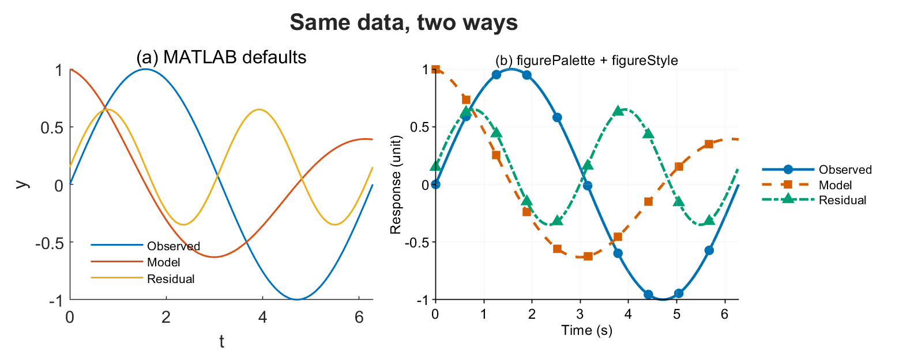

# matlab-scientific-visualization

**English** · [简体中文](README.zh-CN.md)

A Claude Code skill for **publication-quality MATLAB figures**: palettes that survive
greyscale, styles that keep multi-panel figures identical, and exports whose width and DPI are
measured rather than assumed.



*Left: MATLAB defaults. Right: `figurePalette` + `figureStyle` + `figureExport` on the same data.*

## Why this exists

MATLAB's defaults are tuned for interactive exploration, not print: a heavy grid, a seven-colour
cycle never tested for colour-vision deficiency, legends drawn on top of the data, and
`print -dpng -r200` output nobody measures. The result is figures that are readable on screen
and unconvincing in a manuscript.

This skill is a MATLAB port of the `scientific-visualization` skill from
[Scientific Agent Skills](https://skills.sh/k-dense-ai/scientific-agent-skills/scientific-visualization)
by K-Dense Inc., rebuilt around MATLAB's actual API. The principles are theirs; the
implementation, the MATLAB trap table, and the review workflow are new.

## Install

Clone into your Claude Code skills directory:

```bash
git clone https://github.com/jiangfan125-commits/matlab-scientific-visualization.git \
  ~/.claude/skills/matlab-scientific-visualization
```

Then in MATLAB, once per session:

```matlab
home = getenv('USERPROFILE');
if isempty(home), home = getenv('HOME'); end
addpath(fullfile(home, '.claude', 'skills', 'matlab-scientific-visualization', 'scripts'))
```

No toolboxes required. Tested on MATLAB R2024b; `figureExport` falls back to `print` for
vector output, so older releases work too.

## Quick start

```matlab
C  = figurePalette('okabe_ito_on_white', 3);   % 3 series, all >= 3:1 on white
f  = figure('Color','w','Visible','off');
ax = axes(f); hold(ax,'on')
plot(ax, t, y1, '-',  'Color', C(1,:), 'LineWidth', 1.5, 'DisplayName', 'Observed')
plot(ax, t, y2, '--', 'Color', C(2,:), 'LineWidth', 1.5, 'DisplayName', 'Model')
plot(ax, t, y3, '-.', 'Color', C(3,:), 'LineWidth', 1.5, 'DisplayName', 'Residual')
hold(ax,'off')
xlabel(ax,'Time (s)'); ylabel(ax,'Response (unit)')
legend(ax,'Location','eastoutside')

figureStyle('publication', ax, 'WidthMM', 89, 'HeightMM', 60, 'Grid','on')
figureExport(f, 'outputs/fig1', 'Formats', {'pdf','png'}, 'WidthMM', 89, 'DPI', 300, ...
    'Provenance', struct('raw_data','data/obs.csv', 'uncertainty','SD, n = 6'))
```

```
=== outputs/fig1.pdf ===
  format      : pdf
  size        : 8.6 kB
  page        : 88.90 x 59.97 mm

=== outputs/fig1.png ===
  pixels      : 1051 x 709
  effective   : 300 dpi over 89.0 mm
```

## What's in the toolbox

| Function | What it does |
|---|---|
| `figurePalette(name, n)` | 11 categorical palettes (Okabe-Ito, Paul Tol) as `[0 1]` RGB, with per-palette caveats |
| `figureStyle(preset, ax, ...)` | Presets `default`, `publication`, `nature`, `presentation`; sets size, fonts, grid, ticks, colour order |
| `figureExport(fig, base, ...)` | Vector + raster at a stated physical width, refuses silent overwrite, writes a JSON manifest |
| `figureAudit(C, ...)` | WCAG 2.2 contrast and CIE L\* greyscale-separation screen for a colour set |
| `figureMetadata(file, ...)` | Reads the delivered file back: pixel size, effective DPI, PDF page box |
| `figureColormap(name, n)` | `viridis`, `cividis`, `plasma`, `magma` as anchor-interpolated maps |

Plus five reference documents, including eleven runnable MATLAB patterns
(`references/matlab_examples.md`) and a table of MATLAB-specific traps: `axis equal` inside a
small panel, `ColorOrder` not affecting existing lines, CJK font substitution during PDF export.

## What it deliberately does not do

- **No colour-vision simulation.** `figureAudit` computes WCAG contrast and CIE L\* separation.
  That is a screen, not a protocol.
- **No CMYK conversion or ICC handling.** MATLAB can't do it reliably; use a print workflow.
- **No PDF font inspection.** `figureMetadata` parses the page box, not embedded fonts. Check
  those with your publisher's preflight tool.
- **No compliance claims.** The publisher profiles in `assets/` are dated planning snapshots.
  Verify the target journal's live instructions before you upload anything.

## Attribution

Derived from **Scientific Agent Skills**, `scientific-visualization` v1.4, by **K-Dense Inc.**,
released under the MIT License.

> Kassis, T., Agarwal, V., He, Y., Patel, D., & Brueckner, A. M. (2026). *Scientific Agent
> Skills: A Library of Procedural Knowledge for Research Agents.* arXiv:2609.00065.
> https://doi.org/10.48550/arXiv.2609.00065

Palette values follow Bang Wong, *Nature Methods* 8, 441 (2011), and Paul Tol,
SRON/EPS/TN/09-002 issue 3.2 (2021). Full source list in `references/sources.md`.

See [NOTICE.md](NOTICE.md) for the full breakdown of what came from where.

## License

MIT. See [LICENSE](LICENSE).