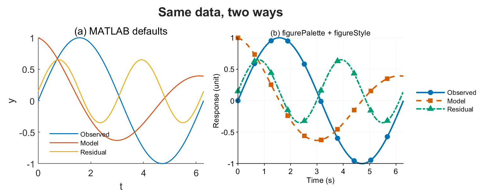

# matlab-scientific-visualization

[English](README.md) · **简体中文**

一个给 **MATLAB 出论文级矢量图** 用的 Claude Code 技能：配色在灰度打印下仍然分得开，
多子图的版式保持一致，导出的宽度和 DPI 都实测过。



*左：MATLAB 默认效果。右：同样的数据，套上 `figurePalette` + `figureStyle` + `figureExport`。*

## 为什么要做这个

MATLAB 的默认设置是为交互探索调的，不是为印刷调的：粗重的网格线、一套从没做过色盲
检验的七色循环、压在数据上的图例，以及 `print -dpng -r200` 这种导出完根本没人量过的
尺寸。结果是图在屏幕上看着还行，放进稿子里就站不住。

这个技能是 [Scientific Agent Skills](https://skills.sh/k-dense-ai/scientific-agent-skills/scientific-visualization)
里 `scientific-visualization`（作者 K-Dense Inc.）的 MATLAB 移植版，按 MATLAB 实际提供的
API 重写了一遍。原则是他们的，实现、MATLAB 陷阱表和审图流程是新写的。

## 安装

克隆到 Claude Code 的技能目录：

```bash
git clone https://github.com/jiangfan125-commits/matlab-scientific-visualization.git \
  ~/.claude/skills/matlab-scientific-visualization
```

然后在 MATLAB 里，每个会话执行一次：

```matlab
home = getenv('USERPROFILE');
if isempty(home), home = getenv('HOME'); end
addpath(fullfile(home, '.claude', 'skills', 'matlab-scientific-visualization', 'scripts'))
```

不需要任何工具箱。在 MATLAB R2024b 上测过；矢量导出走的是 `print` 回退路径，所以老版本
也能用。

## 快速上手

```matlab
C  = figurePalette('okabe_ito_on_white', 3);   % 3 条曲线，在白底上对比度均 >= 3:1
f  = figure('Color','w','Visible','off');
ax = axes(f); hold(ax,'on')
plot(ax, t, y1, '-',  'Color', C(1,:), 'LineWidth', 1.5, 'DisplayName', '观测值')
plot(ax, t, y2, '--', 'Color', C(2,:), 'LineWidth', 1.5, 'DisplayName', '模型')
plot(ax, t, y3, '-.', 'Color', C(3,:), 'LineWidth', 1.5, 'DisplayName', '残差')
hold(ax,'off')
xlabel(ax,'时间 (s)'); ylabel(ax,'响应 (unit)')
legend(ax,'Location','eastoutside')

figureStyle('publication', ax, 'WidthMM', 89, 'HeightMM', 60, 'Grid','on')
figureExport(f, 'outputs/fig1', 'Formats', {'pdf','png'}, 'WidthMM', 89, 'DPI', 300, ...
    'Provenance', struct('raw_data','data/obs.csv', 'uncertainty','SD, n = 6'))
```

```
=== outputs/fig1.pdf ===
  format      : pdf
  size        : 8.6 kB
  page        : 88.90 x 59.97 mm

=== outputs/fig1.png ===
  pixels      : 1051 x 709
  effective   : 300 dpi over 89.0 mm
```

宽度是量出来的：89 mm 报成 88.90 mm，300 DPI 下 89 mm 对应 1051 px。

## 工具箱里有什么

| 函数 | 作用 |
|---|---|
| `figurePalette(name, n)` | 11 套分类配色（Okabe-Ito、Paul Tol），返回 `[0 1]` 区间 RGB，每套附带适用说明 |
| `figureStyle(preset, ax, ...)` | 预设 `default`、`publication`、`nature`、`presentation`；设置尺寸、字体、网格、刻度、配色顺序 |
| `figureExport(fig, base, ...)` | 按指定物理宽度同时导出矢量图和位图，拒绝静默覆盖，写出 JSON 清单 |
| `figureAudit(C, ...)` | 对一组颜色做 WCAG 2.2 对比度和 CIE L\* 灰度分离度筛查 |
| `figureMetadata(file, ...)` | 回头读导出的文件：像素尺寸、实际 DPI、PDF 页面框 |
| `figureColormap(name, n)` | `viridis`、`cividis`、`plasma`、`magma`，按锚点插值生成色图 |

另附五篇参考文档，其中包括十一个可直接运行的 MATLAB 范例
（`references/matlab_examples.md`），以及一张 MATLAB 专属陷阱表：小面板里的
`axis equal`、`ColorOrder` 修改不影响已画的线、PDF 导出时中文字体被替换。

## 它刻意不做的事

- **不做色觉模拟。** `figureAudit` 算的是 WCAG 对比度和 CIE L\* 分离度。那是一道筛查，
  不是完整规程。
- **不做 CMYK 转换和 ICC 管理。** MATLAB 做不可靠；走印刷流程时另找工具。
- **不检查 PDF 内嵌字体。** `figureMetadata` 解析的是页面框，不是字体资源。字体请用出版方
  的 preflight 工具查。
- **不承诺合规。** `assets/` 里的出版商档案是有日期的规划快照。投稿前请核对目标期刊的
  最新要求。

## 出处与致谢

源自 **Scientific Agent Skills**，`scientific-visualization` v1.4，作者 **K-Dense Inc.**，
以 MIT 许可证发布。

> Kassis, T., Agarwal, V., He, Y., Patel, D., & Brueckner, A. M. (2026). *Scientific Agent
> Skills: A Library of Procedural Knowledge for Research Agents.* arXiv:2609.00065.
> https://doi.org/10.48550/arXiv.2609.00065

配色数值依据 Bang Wong, *Nature Methods* 8, 441 (2011) 与 Paul Tol,
SRON/EPS/TN/09-002 issue 3.2 (2021)。完整来源列表见 `references/sources.md`。

逐项说明“哪些来自上游、哪些是新写的”，见 [NOTICE.md](NOTICE.md)。

## 许可证

MIT。见 [LICENSE](LICENSE)。